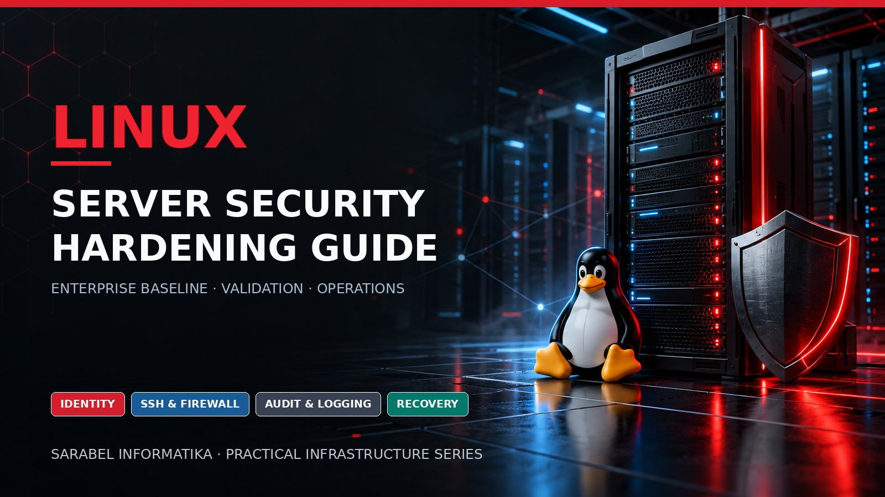

# Linux Server Security Hardening Guide

<p align="center">
  
</p>


[](https://github.com/sarabelinformatika/linux-server-security-hardening-guide/actions/workflows/validate.yml)
[](https://github.com/sarabelinformatika/linux-server-security-hardening-guide/releases/tag/v1.0.0)
[](LICENSE)

A production-oriented guide for hardening, validating, operating, and recovering Debian, Ubuntu, and RHEL-compatible Linux servers. It covers secure build, patching, identity, PAM, sudo, SSH, nftables, IPv6, systemd, kernel policy, SELinux/AppArmor, filesystem integrity, cryptography, audit, central logging, vulnerability management, backup, incident response, and evidence-based acceptance.

This independent guide is published by [SARABEL Informatika Kft.](https://sarabelinformatika.hu) as part of its practical infrastructure and cybersecurity series. For professional Linux server assessment, hardening, monitoring, recovery design, and managed operations, visit [SARABEL Informatika](https://sarabelinformatika.hu).

> Hardening is not a one-time script. It is a versioned, tested, recoverable operating process with measured evidence and owned exceptions.

## Reference operating model

| Layer | Typical controls | Primary objective |
|---|---|---|
| Build | Trusted images, signed repositories, minimal packages | Known and reproducible starting state |
| Identity | Named accounts, MFA, PAM, least-privilege sudo | Attributable administrative access |
| Exposure | nftables, restricted SSH, service minimization | Small and documented attack surface |
| Runtime | Kernel policy, systemd sandboxing, SELinux/AppArmor | Contain compromise and misuse |
| Evidence | auditd, journald, central logs, FIM, scanning | Detect, investigate, and demonstrate control |
| Resilience | Protected backups, restore tests, incident runbooks | Recover safely within RTO and RPO |

## Guide map

1. [Scope, threat model, and baseline selection](docs/01-scope-threat-model-and-baseline-selection.md)
2. [Inventory, classification, and secure build](docs/02-inventory-classification-and-secure-build.md)
3. [Installation, partitioning, boot, and hardware trust](docs/03-installation-partitioning-boot-and-hardware-trust.md)
4. [Packages, repositories, patching, and lifecycle](docs/04-packages-repositories-patching-and-lifecycle.md)
5. [Identity, PAM, sudo, passwords, and MFA](docs/05-identity-pam-sudo-passwords-and-mfa.md)
6. [SSH hardening and bastion access](docs/06-ssh-hardening-and-bastion-access.md)
7. [Network stack, nftables, firewall, DNS, and IPv6](docs/07-network-stack-nftables-firewall-dns-and-ipv6.md)
8. [Service minimization, systemd, and scheduled execution](docs/08-service-minimization-systemd-and-scheduled-execution.md)
9. [Kernel, sysctl, modules, and runtime protection](docs/09-kernel-sysctl-modules-and-runtime-protection.md)
10. [SELinux, AppArmor, and mandatory access control](docs/10-selinux-apparmor-and-mandatory-access-control.md)
11. [Filesystems, permissions, integrity, and data protection](docs/11-filesystems-permissions-integrity-and-data-protection.md)
12. [Cryptography, TLS, PKI, secrets, and FIPS](docs/12-cryptography-tls-pki-secrets-and-fips.md)
13. [auditd, journald, central logging, and time](docs/13-auditd-journald-central-logging-and-time.md)
14. [Vulnerability scanning, OpenSCAP, Lynis, and compliance](docs/14-vulnerability-scanning-openscap-lynis-and-compliance.md)
15. [Backup, recovery, immutability, and incident response](docs/15-backup-recovery-immutability-and-incident-response.md)
16. [Deployment, acceptance, operations, and exceptions](docs/16-deployment-acceptance-operations-and-exceptions.md)

## Included operational material

- Four read-only host assessment scripts
- Example baseline, patch, sysctl-review, and logging YAML files
- Primary sources, limitations, ports, controls, and command catalogue
- Deployment, access, firewall, change, incident, recovery, and exception templates
- GitHub Actions validation for shell, YAML, Markdown links, and common secret patterns

## Quick start

```bash
git clone https://github.com/sarabelinformatika/linux-server-security-hardening-guide.git
cd linux-server-security-hardening-guide
chmod +x scripts/*.sh
sudo ./scripts/linux-host-assessment.sh
sudo ./scripts/linux-network-exposure.sh
./scripts/linux-security-updates-check.sh
./scripts/linux-service-baseline.sh
```

The scripts collect and display state; they intentionally make no configuration changes. Review [SECURITY.md](SECURITY.md), [DISCLAIMER.md](DISCLAIMER.md), and [limitations](reference/limitations.md) before production use.

## Trademark notice

Linux is a registered trademark of Linus Torvalds. Debian, Ubuntu, Red Hat, RHEL, and other product names are trademarks of their respective owners. This independent project is not endorsed by those organizations.

## License

Released under the [MIT License](LICENSE).
